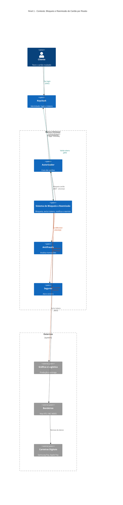

# Bloqueio e reemissão de cartão por roubo

Este documento resume a solução que desenhei para o case e as decisões por trás dela. A ideia é que alguém técnico consiga entender o fluxo, os pontos de falha e por que escolhi cada peça, sem precisar estar na apresentação.

Uma premissa guiou tudo: **o que importa de verdade é impedir novas compras o quanto antes**. Por isso, o bloqueio no autorizador é a única coisa que faço de forma síncrona. Excluir tokens, avisar Antifraude e Seguros e reemitir o cartão são importantes, mas podem acontecer alguns segundos (ou dias, no caso da gráfica) depois.

## Diagramas

Os dois diagramas estão em Mermaid, no padrão C4. Dá para abrir no [mermaid.live](https://mermaid.live) ou em qualquer visualizador de Markdown que suporte Mermaid.

As cores das setas ajudam a ler:
- preta: chamada síncrona (REST)
- laranja: comandos assíncronos
- roxa: resultados das etapas, voltando para o orquestrador
- verde: autenticação e tokens

Os números nas setas seguem a ordem real das operações.

### Contexto (nível 1)



### Containers (nível 2)

```mermaid
---
config:
  c4:
    c4ShapeMargin: 40
    width: 180
---
C4Container
    title Nível 2 - Containers: Bloqueio e Reemissão de Cartão por Roubo

    Person(cliente, "Cliente", "Teve o cartão roubado")
    Container(app, "App Mobile", "iOS / Android", "Microfrontend de Cartões")
    Container(gw, "API Gateway Cartões", "AWS API Gateway", "Rotas Cartões, rate limit")
    Container(kc, "Keycloak", "OIDC / OAuth2", "Login OIDC, tokens com papéis")
    System(core, "Autorizador", "Core de cartões")

    Boundary(b1, "Domínio Cartões - BFF e Orquestração") {
        Container(bff, "BFF Cartões", "Node / Kotlin", "Time Cartões, Idempotency-Key")
        Container(orq, "Block Orchestrator", "Java / Spring", "Saga, outbox, checa posse do cartão")
    }

    Boundary(b2, "Persistência e Mensageria") {
        ContainerDb(db, "DB Orquestrador", "PostgreSQL", "Estado, outbox, idempotência")
        ContainerQueue(sns, "card-events", "SNS FIFO", "Comandos: CardBlocked")
        ContainerQueue(qres, "fila-resultados", "SQS FIFO", "Assina card-step-results")
    }

    Boundary(b3, "Filas SQS FIFO com DLQ e tópico de resultados") {
        ContainerQueue(qtok, "fila-tokens", "SQS FIFO")
        ContainerQueue(qemi, "fila-reemissao", "SQS FIFO")
        ContainerQueue(qaf, "fila-antifraude", "SQS FIFO")
        ContainerQueue(qseg, "fila-seguros", "SQS FIFO")
        ContainerQueue(snsres, "card-step-results", "SNS FIFO", "Resultados das etapas")
    }

    Boundary(b4, "Consumidores") {
        Container(token, "Token Service", "Java", "Exclui tokens, idempotente")
        Container(issue, "Card Issuance", "Java", "Reemissão, envia à gráfica")
        System(antifraude, "Antifraude", "Analisa transações")
        System(seguros, "Seguros", "Abre sinistro")
    }

    Boundary(b5, "Externos") {
        System_Ext(bandeira, "Bandeiras", "Visa VTS / MC MDES")
    }

    Rel(cliente, app, "Usa")
    Rel(app, gw, "1. POST /v1/cards/{cardId}/block-requests", "HTTPS + JWT + Idempotency-Key")
    Rel(gw, bff, "2. POST /v1/cards/{cardId}/block-requests", "REST síncrono")
    Rel(bff, orq, "3. POST /internal/block-processes", "REST síncrono")
    Rel(orq, core, "4. PATCH /cards/{cardId}/status", "REST síncrono, BLOCKED_THEFT")
    Rel(orq, db, "5. INSERT estado + outbox", "mesma transação")
    Rel(orq, sns, "6. Publish CardBlocked", "outbox relay")
    Rel(sns, qtok, "fan-out")
    Rel(sns, qemi, "fan-out")
    Rel(sns, qaf, "fan-out")
    Rel(sns, qseg, "fan-out")
    Rel(token, qtok, "ReceiveMessage")
    Rel(issue, qemi, "ReceiveMessage")
    Rel(antifraude, qaf, "ReceiveMessage")
    Rel(seguros, qseg, "ReceiveMessage")
    Rel(token, snsres, "7. Publish TokensDeleted")
    Rel(issue, snsres, "7. Publish CardReissued")
    Rel(antifraude, snsres, "7. Publish FraudCaseOpened")
    Rel(seguros, snsres, "7. Publish ClaimRegistered")
    Rel(snsres, qres, "assinatura")
    Rel(orq, qres, "8. ReceiveMessage", "long polling")
    Rel(gw, kc, "Valida JWT", "JWKS")
    Rel(orq, kc, "Token cards:block", "client credentials")
    Rel(token, bandeira, "POST /tokens/{tokenRef}/delete", "REST + circuit breaker")

    UpdateRelStyle(app, gw, $offsetY="60")
    UpdateRelStyle(bff, orq, $offsetY="50")
    UpdateRelStyle(orq, db, $offsetX="-90")
    UpdateRelStyle(orq, sns, $textColor="#c2410c", $lineColor="#c2410c")
    UpdateRelStyle(sns, qtok, $textColor="#c2410c", $lineColor="#c2410c")
    UpdateRelStyle(sns, qemi, $textColor="#c2410c", $lineColor="#c2410c")
    UpdateRelStyle(sns, qaf, $textColor="#c2410c", $lineColor="#c2410c")
    UpdateRelStyle(sns, qseg, $textColor="#c2410c", $lineColor="#c2410c")
    UpdateRelStyle(token, qtok, $textColor="#c2410c", $lineColor="#c2410c", $offsetY="40")
    UpdateRelStyle(issue, qemi, $textColor="#c2410c", $lineColor="#c2410c", $offsetX="-45", $offsetY="40")
    UpdateRelStyle(antifraude, qaf, $textColor="#c2410c", $lineColor="#c2410c", $offsetX="-55", $offsetY="40")
    UpdateRelStyle(seguros, qseg, $textColor="#c2410c", $lineColor="#c2410c", $offsetY="40")
    UpdateRelStyle(token, snsres, $textColor="#7c3aed", $lineColor="#7c3aed", $offsetY="-25")
    UpdateRelStyle(issue, snsres, $textColor="#7c3aed", $lineColor="#7c3aed", $offsetY="5")
    UpdateRelStyle(antifraude, snsres, $textColor="#7c3aed", $lineColor="#7c3aed", $offsetY="-25")
    UpdateRelStyle(seguros, snsres, $textColor="#7c3aed", $lineColor="#7c3aed", $offsetY="5")
    UpdateRelStyle(snsres, qres, $textColor="#7c3aed", $lineColor="#7c3aed")
    UpdateRelStyle(orq, qres, $textColor="#7c3aed", $lineColor="#7c3aed", $offsetX="80")

    UpdateRelStyle(gw, kc, $textColor="#0f766e", $lineColor="#0f766e", $offsetY="60")
    UpdateRelStyle(orq, kc, $textColor="#0f766e", $lineColor="#0f766e", $offsetX="105", $offsetY="-80")
    UpdateRelStyle(orq, core, $offsetY="15")

    UpdateLayoutConfig($c4ShapeInRow="5", $c4BoundaryInRow="1")
```



## Como o fluxo funciona

O cliente faz login pelo Keycloak e pede o bloqueio no app. A chamada passa pelo API Gateway Cartões, que valida o token, e pelo BFF Cartões, que adapta o contrato e repassa a `Idempotency-Key`. Daí ela chega ao Block Orchestrator.

O orquestrador faz duas coisas antes de responder:
1. Confere se o cartão realmente pertence ao cliente do token. Sem isso, qualquer pessoa logada poderia bloquear o cartão de outra (o famoso BOLA/IDOR).
2. Chama o autorizador para mudar o status do cartão para `BLOCKED_THEFT`.

Depois disso, grava numa única transação o estado do processo, uma linha para cada etapa pendente e o evento `CardBlocked` na tabela de outbox. Só então responde `202` para o app. Para o cliente, nesse momento o cartão já está bloqueado.

Um job dentro do próprio orquestrador lê a outbox e publica no tópico SNS `card-events`. O SNS entrega uma cópia para cada fila SQS: tokens, reemissão, antifraude e seguros. Cada consumidor faz a sua parte e publica o resultado em outro tópico, o `card-step-results`. A `fila-resultados` assina esse tópico, e o orquestrador consome dela para ir marcando cada etapa como concluída.

### API

```
POST /v1/cards/{cardId}/block-requests
Authorization: Bearer <JWT>
Idempotency-Key: <uuid>

{ "reason": "THEFT", "reissue": true, "deliveryAddressId": "..." }

-> 202 { "processId": "p-123", "status": "CARD_BLOCKED" }
```

Para acompanhar: `GET /v1/block-requests/{processId}`.

Internamente, o BFF chama `POST /internal/block-processes` (rota que não fica exposta no gateway) e o orquestrador chama `PATCH /cards/{cardId}/status` no autorizador. A rota de exclusão de tokens no diagrama é ilustrativa, porque a Visa (VTS) e a Mastercard (MDES) têm APIs próprias.

### Eventos

Todos os eventos usam o mesmo envelope:

```json
{
  "eventId": "uuid",
  "eventType": "CardBlocked",
  "processId": "p-123",
  "step": null,
  "cardId": "c-456",
  "occurredAt": "2026-11-16T10:30:00Z",
  "payload": {}
}
```

Nos eventos de resultado, o `step` vem preenchido (`TOKENS`, `REISSUE`, `ANTIFRAUDE`, `SEGUROS`). Um cuidado importante: o número do cartão (PAN) nunca trafega nos eventos, só IDs internos, por causa do PCI.

## Por que outbox

Eu poderia publicar o evento direto no SNS logo depois de gravar no banco, mas aí teria uma escrita dupla. Se o serviço cair entre um passo e outro, o cartão fica bloqueado e ninguém mais fica sabendo: os tokens continuam ativos, Antifraude e Seguros não recebem nada.

Com a outbox, o estado e o evento entram na mesma transação. Ou os dois são gravados, ou nenhum. O preço é que a entrega passa a ser *at-least-once*: o mesmo evento pode chegar mais de uma vez. Por isso, todo consumidor precisa ser idempotente.

## Mensageria

Escolhi SNS + SQS FIFO em vez de Kafka. O volume aqui é baixo (bloqueio por roubo não é um evento frequente), e ganho retry e DLQ nativos, sem cluster para operar. O que perco é a facilidade de reprocessar eventos antigos (replay), que no Kafka é nativa.

Algumas configurações que fazem diferença:
- `MessageGroupId = cardId`, para manter a ordem dos eventos de um mesmo cartão;
- `MessageDeduplicationId = eventId`, que descarta duplicatas numa janela de 5 minutos;
- visibility timeout maior que o tempo de processamento do consumidor;
- `maxReceiveCount` em torno de 5 e, depois disso, DLQ com alarme.

Separei comandos e resultados em dois tópicos de propósito. Com um tópico só, cada fila precisaria de filter policy, senão a fila de tokens receberia o `TokensDeleted` que o próprio Token Service publicou.

Dentro de cada consumidor, a ordem é: executa a ação, publica o resultado e só então apaga a mensagem da fila. Se cair no meio, a mensagem volta e é reprocessada. Como a ação é idempotente, isso não causa problema.

## Idempotência

Resumindo onde ela aparece:
- na entrada da API, com a `Idempotency-Key` e uma unique constraint em `(customerId, idempotencyKey)`. Toque duplo no botão devolve o mesmo processo;
- no autorizador, onde bloquear um cartão já bloqueado não muda nada;
- nos consumidores, que guardam os `eventId` já processados;
- na exclusão de tokens, em que "token não encontrado" conta como sucesso;
- na reemissão, que usa o `processId` como chave para nunca gerar dois cartões.

## Acompanhamento e falhas

Quando o bloqueio acontece, o orquestrador cria uma linha para cada etapa, com status `PENDING` e um prazo (`deadline_at`). Os eventos de resultado vão atualizando essas linhas.

O ponto que mais gosto de destacar: **em sistema assíncrono, falha costuma ser silêncio**. Se o serviço de Seguros cair, ninguém avisa o orquestrador; a mensagem só fica parada na fila. Por isso existe um job (sweeper) que procura etapas pendentes com prazo vencido, marca como `TIMED_OUT` e dispara alerta. Se a resposta chegar depois, a etapa vai para `DONE` normalmente.

O processo fica `COMPLETED` quando todas as etapas confirmam, ou `COMPLETED_WITH_PENDINGS` se alguma estiver em timeout ou falha. Só considero o processo `FAILED` se o bloqueio em si falhar. Falhas nas etapas seguintes nunca desfazem o bloqueio; a recuperação é sempre para frente, com retry, DLQ e reprocessamento.

Alguns cenários que costumam aparecer:

- **Autorizador fora do ar:** faço retry curto com circuit breaker. Se não resolver, retorno erro para o app orientar o cliente a ligar na central. Não dá para dizer "bloqueado" sem ter bloqueado.
- **API da bandeira fora do ar:** a exclusão de tokens fica em retry e depois vai para a DLQ. O cliente continua protegido, porque compras com token são destokenizadas pela bandeira e chegam ao autorizador, que já nega.
- **Orquestrador cai depois do commit:** a outbox garante que o evento seja publicado quando ele voltar.
- **Mensagem que sempre quebra:** vai para a DLQ, a etapa vira `FAILED` e fica disponível para redrive.
- **Bloqueio feito por outro canal (URA, backoffice):** todos os canais deveriam usar a API do orquestrador. Como rede de segurança, o autorizador publica um `CardStatusChanged`, e o orquestrador abre um processo quando encontra um bloqueio que não começou por ele.

Para rastrear, o `processId` vai como `correlationId` em logs, traces e eventos. Os alarmes que eu colocaria: mensagens em DLQ, idade da mensagem mais antiga em cada fila, etapas em timeout e erro e latência nas chamadas ao autorizador.

## Segurança

Só o gateway é público; o resto fica em subnets privadas. O Keycloak cuida do login do cliente (OIDC) e dos tokens de serviço (client credentials). O orquestrador recebe um token com o papel `cards:block`, e o autorizador só aceita bloqueios vindos de quem tem esse papel. Nenhum serviço desse fluxo consegue desbloquear um cartão.

No SNS e no SQS, as resource policies garantem que só o orquestrador publique em `card-events`, só os workers publiquem em `card-step-results`, e cada fila só aceite mensagens do tópico de origem.

Cheguei a considerar o OPA para as políticas, mas para este escopo os papéis no token resolvem. A checagem de posse do cartão fica no domínio, que é onde o dado está. O OPA faria sentido se as regras ficassem mais complexas ou passassem a ser mantidas por um time de segurança.

## O que eu mudaria ou evoluiria

- Trocar o orquestrador próprio por AWS Step Functions, que já traz estado, timeout e retry por etapa.
- Em vez de só excluir os tokens de pagamentos recorrentes (Netflix e afins), atualizar o vínculo para o novo cartão, usando o *token lifecycle* das bandeiras. O token da carteira do celular, esse sim, deve ser excluído, porque o aparelho pode ter sido roubado junto.
- Liberar um cartão virtual na hora, enquanto o físico não chega.

Fico à vontade para discutir qualquer uma dessas escolhas. Nenhuma delas é a única resposta possível, e várias dependem do contexto da empresa (volume, times, o que já existe na infraestrutura).
